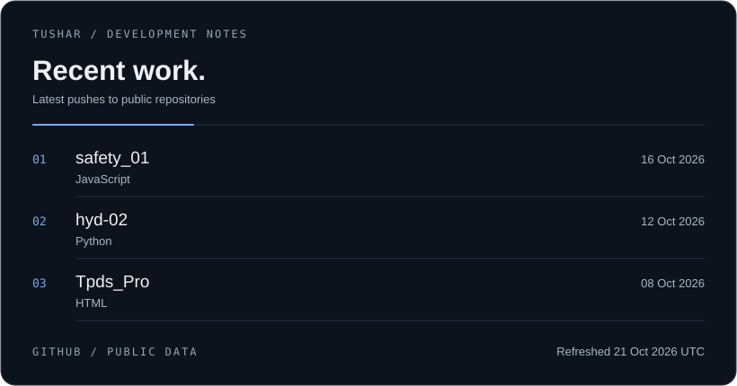

<!-- HERO -->

 

# Tushar Singh

### Full-Stack Developer · CS Undergraduate · AI Research Explorer

Building useful products, exploring intelligent systems, and learning by shipping.

  <a href="https://github.com/TusharSingh14x?tab=repositories">Projects</a> ·
  <a href="https://www.linkedin.com/in/tushar-singh-392a3031a/">LinkedIn</a> ·
  <a href="mailto:bt24csd001@gmail.com">Email</a>

---

## `$ whoami`

I'm a Computer Science undergraduate focused on building full-stack applications and strengthening my foundations in software engineering.

I enjoy working across the stack — from designing responsive interfaces to building APIs, integrating databases, and deploying applications.

Beyond web development, I'm exploring **machine learning, deep learning, NLP, and quantum computing**, with an interest in understanding where these research areas intersect.

- **Currently building:** Full-stack applications with TypeScript, React, and Node.js.
- **Currently learning:** Better software architecture, ML/DL fundamentals, and research methods.
- **Exploring next:** NLP and quantum computing research directions.
- **Approach:** Build things, understand the fundamentals, and keep improving.

## `$ tech-stack`

**Languages**

**Frontend & Backend**

**Databases & Tools**

## `$ selected-work`

Explore my repositories for projects involving web development, backend engineering, and experimentation with emerging technologies.

> Tip: Pin your best 3–6 repositories on your GitHub profile so visitors can immediately see your strongest work.

## `$ recent-work`

Latest updates to my public repositories, generated from GitHub data.

## `$ contribution-graph`

## `$ connect`

<a href="https://github.com/TusharSingh14x">GitHub</a> ·
<a href="https://www.linkedin.com/in/tushar-singh-392a3031a/">LinkedIn</a> ·
<a href="mailto:bt24csd001@gmail.com">Email</a>

  

*Building. Learning. Shipping.*

